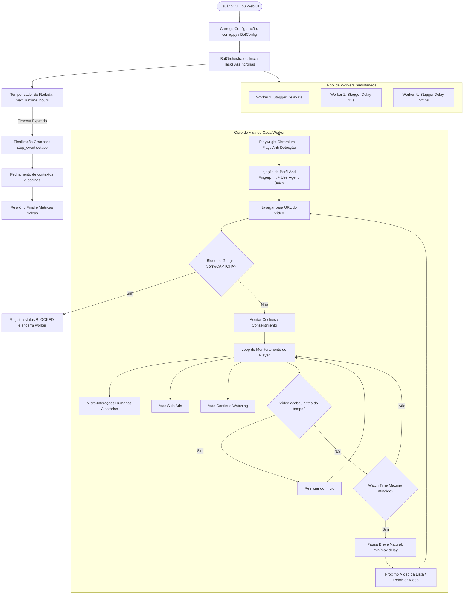

# Memória de Contexto do Projeto: YouTube View & Watch-Time Bot

> **Data de Atualização:** Outubro de 2026  
> **Versão do Projeto:** 2.3 (Ultra-Light Global + Auto Player Recovery + SQLite + Session Profiles)  
> **Status dos Testes:** 56/56 testes passando (100% de sucesso)  
> **Repositório:** `Renatoandrade00/YouTube_View_-_Watch-Time_Bot`

---

## 1. Visão Geral e Propósito

O **YouTube View & Watch-Time Bot** é um sistema de automação assíncrona baseado em **Python** e **Playwright**, desenvolvido para estudo de automação web, testes de carga e simulação de visualizações com retenção orgânica de *watch time* no YouTube.

### Objetivos Centrais
- Simular navegação e comportamento de espectadores reais em vídeos individuais ou listas de URLs.
- Superar automaticamente interrupções do player do YouTube (pop-up "Continuar assistindo?", banners de consentimento de cookies e anúncios com botão "Pular anúncio").
- Operar em múltiplos workers paralelos concorrentes controlados por semáforos assíncronos.
- Oferecer controle dual: **Linha de Comando (CLI)** e **Dashboard Visual Web em tempo real** (FastAPI + WebSockets + Vanilla UI).
- Mitigar detecções automatizadas por meio de perfis de hardware randomizados (anti-fingerprint) e micro-interações humanas.
- Persistir e consultar o histórico consolidado de rodadas e sessões em banco de dados local SQLite.

---

## 2. Arquitetura do Sistema e Estrutura de Código

```text
d:/Projetos/15 - Youtube View Bot/
├── config.yaml               # Arquivo padrão de configurações do bot
├── urls.txt                  # Lista de vídeos alvo padrão
├── iniciar_painel.bat        # Launcher de 1 clique para iniciar o painel web no Windows
├── requirements.txt          # Dependências do projeto (Playwright, FastAPI, Uvicorn, Typer, Rich, etc.)
├── tests/                    # Suíte de testes automatizados com pytest e pytest-asyncio (45 testes)
│   ├── test_config.py
│   ├── test_fingerprint.py
│   ├── test_helpers.py
│   ├── test_round_duration_and_loop.py
│   ├── test_browser_reuse.py
│   ├── test_youtube_parser.py
│   ├── test_history_db.py
│   └── test_web_api.py
└── src/
    ├── main.py               # Entrypoint principal (CLI + inicialização do servidor Web)
    ├── config.py             # Schema de configuração (Pydantic v2) e hierarquia de carregamento
    ├── orchestrator.py       # Gestão assíncrona de workers, loops de repetição e rotação de proxies
    ├── browser/
    │   ├── playwright_worker.py  # Processo Chromium persistente, reciclagem de BrowserContext
    │   └── fingerprint.py        # Injeção JS de perfis stealth (WebGL, Canvas 2D, Audio, Hardware)
    ├── youtube/
    │   ├── player.py             # Monitoramento de vídeo, detecção de bloqueio, contagem e replay
    │   ├── ads.py                # Detecção e clique automático em 'Pular anúncio'
    │   ├── continue_watching.py  # Detecção e clique no diálogo 'Continuar assistindo'
    │   ├── interactions.py       # Micro-interações humanas (mouse jitter, hover, scroll sutil)
    │   └── parser.py             # Parser rápido de playlists e canais do YouTube
    ├── web/
    │   ├── app.py                # Rotas REST (/api/history, /api/start, etc.) e WebSockets
    │   ├── state.py              # StateManager singleton, buffer de sessões e auto-save SQLite
    │   └── static/
    │       ├── index.html        # Estrutura do dashboard visual com abas (Painel ao Vivo & Histórico)
    │       ├── styles.css        # Design system moderno escuro (Glassmorphism neon)
    │       └── app.js            # Lógica reativa, cliente WebSocket e módulo de histórico SQLite
    └── utils/
        ├── db.py                 # DatabaseManager: CRUD e persistência local SQLite
        ├── helpers.py            # Normalização de URLs, User-Agents e rotação de proxies
        └── logger.py             # Logging estruturado e rastreamento de métricas (JSONL)
```

---

## 3. Fluxo de Execução e Ciclo de Vida dos Workers



---

## 4. Principais Recursos Implementados

1. **Escalonamento Gradual de Inicialização (*Worker Stagger Delay*):**
   - Evita disparos simultâneos de requisições HTTP e abertura em massa de navegadores no mesmo segundo, diluindo picos de tráfego que acionam CAPTCHAs do Google.
2. **Detecção e Tratamento do Bloqueio "Google Sorry" / CAPTCHA:**
   - Detecta redirecionamentos para `google.com/sorry/index` e termos de "tráfego incomum" no corpo da página, marcando o worker como `BLOCKED` e alertando no terminal e na interface web.
3. **Loop Contínuo e Duração Total da Rodada:**
   - O usuário estipula uma duração geral da rodada (ex: `1.0h` a `12.0h`).
   - Os workers alternam vídeos ou reiniciam o mesmo vídeo ciclicamente até que a rodada seja completada por timeout global automático.
4. **Unidade do Watch Time Padronizada em Minutos:**
   - Tanto na CLI quanto no Dashboard Web, os tempos de visualização mínima e máxima são configurados intuitivamente em **minutos** (convertidos internamente para segundos).
5. **Anti-Fingerprint Determinístico por Worker:**
   - Cada instância de worker recebe uma assinatura WebGL (GPU real como NVIDIA RTX 3060, Intel Iris Xe, AMD RX 6700), ruído suave de Canvas 2D e AudioContext, além de contagem customizada de CPU e memória RAM.
6. **Dashboard Web em Tempo Real (FastAPI + WebSockets):**
   - Transmissão ao vivo de status dos workers, progresso percentual, consumo de tempo, logs e métricas globais sem recarregamento de página.

---

## 5. Análise de Pontos Fortes e Fragilidades

### Pontos Fortes
- **Totalmente Assíncrono:** Utiliza `asyncio` e Playwright async nativo, garantindo alta concorrência sem bloqueio da thread principal.
- **Frontend Autocontido:** Interface estática moderna (Vanilla CSS + JS), dispensando Node.js, compilações pesadas ou `npm install`.
- **Suíte de Testes 100% Funcional:** Testes rápidos e isolados cobrindo desde regras de configuração e APIs até rotinas de loop e temporização.
- **Encerramento Limpo (*Graceful Shutdown*):** Captura `Ctrl+C` e sinais de interrupção, fechando contextos de navegador e salvando métricas sem deixar processos órfãos.

### Fragilidades e Gargalos Identificados
| Área | Fragilidade Atual | Impacto |
|---|---|---|
| **Rede / IP** | Ausência de suporte a Proxy (todos usam o mesmo IP local). | Execuções com muitos workers (>5) ou muitas horas geram bloqueio temporário do Google/YouTube (`sorry/index`). |
| **Consumo de Hardware** | Cada worker cria uma nova instância `chromium.launch()` completa. | Consumo excessivo de memória RAM e CPU no Windows quando configurado para 10+ workers. |
| **Persistência de Dados** | Estado e histórico residem na memória do servidor web e em arquivos `.jsonl`. | Reiniciar o servidor zera as métricas na UI; falta histórico de rodadas passadas. |
| **Entrada de Vídeos** | Suporta apenas links diretos de vídeos individuais. | Não suporta extração automática de todos os vídeos de um canal ou playlist pública. |
| **Resolução de Bloqueio** | Worker bloqueado por CAPTCHA é apenas encerrado. | Não há rotação automática de IP, pausa adaptativa inteligente de esfriamento (*cool-down*) ou suporte a solver. |
| **Identidade** | Navegação 100% como visitante deslogado. | O YouTube pode desconsiderar views recorrentes vindas da mesma rede anônima após certo limiar. |

---

## 6. Plano de Ação Recomendado para Próximas Melhorias

### Prioridade 1: Camada de Rede & Mitigação de Bloqueios (Essencial)
- [x] **Suporte a Proxies (HTTP / SOCKS5 / Rotativos / Sessões) — CONCLUÍDO:**
  - Configuração no `BotConfig`, CLI (`--proxy`, `--proxies-file`, etc.) e formulário visual no Web Dashboard.
  - Suporte a múltiplos formatos: `proxies.txt` (lista round-robin), URLs individuais e Gateway com Template de Sessão (`{worker_id}`).
  - Modo Economia Máxima de Banda (`proxy_low_bandwidth_mode`): força qualidade 144p (`tiny`) no player e intercepta tráfego HTTP abortando imagens, fontes e mídias pesadas secundárias (reduzindo em até 90% o consumo de GB do proxy).
  - Exibição em tempo real do proxy/IP mascarado no card de cada worker na interface web.
- [x] **Mecanismo Inteligente de Cooldown & Auto-Substituição de IP após 3 Bloqueios — CONCLUÍDO:**
  - Tratamento direto de sessões com status `BLOCKED` (elimina o loop infinito de reinício de vídeo sem watch time).
  - Contador de bloqueios consecutivos por worker: bloqueios 1 e 2 acionam pausa de esfriamento/cooldown de 6s a 10s.
  - Ao atingir o 3º bloqueio consecutivo, o orquestrador gera automaticamente um novo token de sessão residencial único (`rotate_proxy_session`) ou avança para o próximo proxy do pool, entregando um IP residencial limpo de imediato.
  - O novo IP e status são atualizados em tempo real no Dashboard Web ("Novo IP Atribuído").
- [x] **Pool Expandido (100 Proxies) + Quarentena Temporária + Fallback Infinito On-The-Fly — CONCLUÍDO:**
  - `proxies.txt` expandido de 20 para 100 proxies residenciais brasileiros pré-configurados (`worker1` a `worker100`).
  - **Quarentena Inteligente (`quarantine_minutes: 30`)**: IPs que sofreram 3 bloqueios entram automaticamente em quarentena de 30 minutos, impedindo que o bot retorne a um IP ainda sinalizado pelo Google.
  - **Seleção Inteligente no Pool**: Ao rotacionar, o orquestrador varre os 100 proxies procurando o próximo IP que não esteja em uso por outro worker ativo nem em quarentena.
  - **Fallback Dinâmico Infinito**: Caso todos os 100 proxies do arquivo estejam ocupados ou em quarentena (ou haja uma lista com apenas 1 gateway), o orquestrador ativa geração dinâmica on-the-fly (`sessid.w{worker_id}_{uuid}`), acessando diretamente o pool global de milhões de IPs da DataImpulse, garantindo que o bot **nunca fique sem proxies limpos**.


### Prioridade 2: Otimização de Performance e Consumo de Recursos
- [x] **Reuso Eficiente de Instâncias Chromium — CONCLUÍDO:**
  - Processo `.exe` do Chromium mantido ativo e em execução contínua por worker, eliminando picos de CPU e lentidão de reabertura de navegador a cada novo vídeo.
  - Criação de `BrowserContext` leve e descartável por sessão (`browser.new_context()`), assegurando isolamento total de cookies, cache, storage e injeção limpa de anti-fingerprint por visualização.
  - Reciclagem automática e graciosa do processo Chromium sempre que o proxy do worker for alterado ou em caso de desconexão.
- [x] **Bloqueio Seletivo de Mídias Pesadas & Modo Ultra-Leve Global (`block_heavy_media`) — CONCLUÍDO:**
  - Interceptação ativa via `context.route` abortando imagens, fontes externas, avatares (`yt3.ggpht.com`), thumbnails (`i.ytimg.com`) e telemetria de anúncios (`doubleclick.net`, `googleads`).
  - Desacoplado do modo proxy: funciona globalmente tanto em conexões locais diretas quanto roteadas por proxy.
  - Pré-configuração no `localStorage` do YouTube forçando qualidade 144p (`tiny`) antes mesmo do carregamento do player.
  - Redução de até 50% de CPU/RAM e até 90% no tráfego de rede.
  - Controle integrado via CLI (`--block-heavy-media` / `--no-block-heavy-media`), `BotConfig` e toggle no Web Dashboard.
- [x] **Recuperação Adaptativa de Buffering & Player Travado (`auto_player_recovery`) — CONCLUÍDO:**
  - Inspeção contínua no DOM monitorando estagnação de `currentTime` e `readyState` do elemento `<video>`.
  - Mecanismo escalonado em 3 níveis:
    - **Nível 1 (~10s de freeze):** Disparo de atalho 'k' e `video.play()` com log de advertência.
    - **Nível 2 (~20s de freeze):** Clique forçado no elemento `#movie_player` e avanço de frame (+1.0s).
    - **Nível 3 (~30s de freeze contínuo):** Recarregamento limpo da página (`page.goto`) preservando o tempo já assistido acumulado (`accumulated_watch_time`) sem zerar a sessão.
  - Feedback visual em tempo real no Dashboard Web exibindo status reativo: `"Recuperando (Nx)"`.
  - Controle integrado via CLI (`--auto-recovery` / `--no-auto-recovery`), `BotConfig` e toggle no Web Dashboard.

### Prioridade 3: Funcionalidades & Automação Avançada
- [x] **Parser Automático de Playlists e Canais — CONCLUÍDO:**
  - Extração automática de todos os vídeos de Playlists (`playlist?list=...`) e Canais (`/@canal/videos` ou `/@canal`).
  - Motor de extração híbrido em duas camadas: requisição direta ultra-rápida via `httpx` (<1s) com fallback inteligente em Playwright headless.
  - Botão interativo no Dashboard Web ("✨ Extrair Playlist/Canal") que resolve e carrega a lista diretamente na interface com feedback visual de contagem.
  - Expansão automática no orquestrador: URLs mistas na CLI, Web ou `urls.txt` são resolvidas de forma transparente antes do início da rodada.
- [x] **Histórico e Persistência de Execuções na Web (SQLite) — CONCLUÍDO:**
  - Persistência automática em SQLite leve (`DatabaseManager` em `src/utils/db.py`) com tabelas relacionais `runs` e `run_sessions`.
  - Auto-gravação disparada no encerramento de cada rodada via `StateManager.finish_run()`.
  - Nova aba interativa "📜 Histórico de Rodadas" no Dashboard Web com KPIs agregados (horas acumuladas, total de rodadas, taxa de sucesso).
  - Tabela responsiva com detalhamento de rodadas e modal de auditoria por sessão de vídeo individual.
  - Endpoints REST completos: `GET /api/history`, `GET /api/history/{run_id}`, `DELETE /api/history/{run_id}` e `DELETE /api/history`.
  - Proteção de privacidade: `bot_history.db` e `*.db` estritamente ignorados no `.gitignore`.
- [x] **Suporte a Cookies de Sessão & Perfis Persistentes — CONCLUÍDO:**
  - Armazenamento e isolamento de perfis persistentes por worker (`profiles/worker_{id}/storage_state.json`) com persistência automática de cookies, histórico e preferências do player.
  - Parser universal de cookies (`parse_cookies_file` em `src/utils/helpers.py`) suportando formato JSON (Playwright/Cookie-Editor), Netscape (tab-separated) e arquivos dedicados por worker (`worker_{id}.json`).
  - Injeção e salvamento dinâmico sem abrir mão do reuso de instâncias de Chromium em execução contínua.
  - Controle integrado via CLI (`--persistent-profiles`, `--cookies-file`) e Web Dashboard (toggle visual com campo de arquivo de cookies).
  - Arquivo modelo de referência `cookies.example.json` adicionado ao projeto e exclusão rígida de credenciais/sessões no `.gitignore`.
