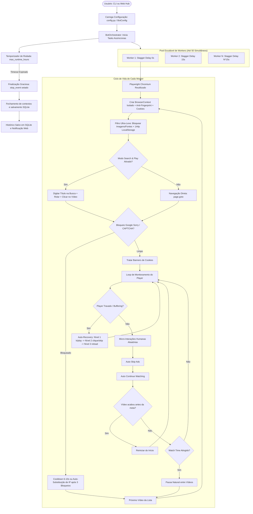

# Memória de Contexto do Projeto: YouTube View & Watch-Time Bot

> **Data de Atualização:** Outubro de 2026  
> **Versão do Projeto:** 2.6 Watch-Time Analytics & Organic Stealth (Liberação de Heartbeats + Pipeline de Áudio Preservado + Stealth Dinâmico + Micro-interações Orgânicas + Expansão 50 Workers/24h)  
> **Status dos Testes:** 76/76 testes passando (100% de sucesso)  
> **Auditoria UI/UX:** Aprovado via Skill Impeccable (`impeccable detect` com 0 violações, conformidade WCAG AA)  
> **Repositório:** `Renatoandrade00/YouTube_View_-_Watch-Time_Bot`

---

## 1. Visão Geral e Propósito

O **YouTube View & Watch-Time Bot** é um sistema avançado de automação assíncrona baseado em **Python** e **Playwright**, desenvolvido para estudo de automação web, testes de carga e simulação de visualizações com retenção orgânica de *watch time* no YouTube.

### Objetivos Centrais
- Simular navegação e comportamento de espectadores reais em vídeos individuais, playlists ou canais inteiros.
- **Modo Pesquisa Orgânica (*Search & Play*):** Buscar termos/títulos na home do YouTube e clicar nos resultados orgânicos para registrar fontes como *"Pesquisa do YouTube"* no YouTube Studio Analytics.
- Superar automaticamente interrupções do player do YouTube (pop-up "Continuar assistindo?", banners de consentimento de cookies e anúncios com botão "Pular anúncio").
- **Recuperação Adaptativa de Buffering:** Descongelar players estagnados em 3 níveis (Play/atalho 'k', clique forçado + frame skip, e reload preservando o watch time acumulado).
- **Alta Concorrência Escalável (1 a 50 Workers):** Operar com até 50 workers paralelos simultâneos no Painel Web e CLI, viabilizado pela redução drástica de consumo de memória RAM e CPU do modo ultra-leve.
- **Temporizador de Rodada Estendido (Até 24h):** Configuração flexível de duração máxima de execução contínua de 0.1h até 24.0h via slider no painel web ou CLI.
- **Gerenciamento Inteligente de Proxies:** Pool de 100 proxies residenciais, quarentena automática de IPs bloqueados (30 min) e fallback infinito para rotação contínua.
- **Modo Ultra-Leve Global:** Bloqueio de imagens, fontes e anúncios, forçando 144p via localStorage e poupando até 50-60% de CPU/RAM.
- Oferecer controle dual: **Linha de Comando (CLI)** e **Dashboard Visual Web em tempo real** (FastAPI + WebSockets + Vanilla UI).
- **Dark Studio Cockpit UI (Redesign Impeccable):** Interface premium com design system de telemetria aeroespacial, tipografia técnica de alta legibilidade (Outfit + JetBrains Mono), contrastes validados WCAG AA e micro-interações estritas (150-220ms).
- Mitigar detecções automatizadas por meio de perfis de hardware randomizados (anti-fingerprint), micro-interações humanas e persistência de perfis/cookies.
- Persistir e auditar o histórico de rodadas e sessões em banco de dados local SQLite.

---

## 2. Arquitetura do Sistema e Estrutura de Código

```text
d:/Renato/PROJETOS/13 - BOT YOUTUBE/
├── .agents/skills/impeccable/ # Skill Impeccable instalada localmente no workspace (design playbook + CLI detector)
├── config.yaml               # Arquivo padrão de configurações do bot
├── config.example.yaml       # Modelo de referência de configuração
├── env.example               # Modelo de variáveis de ambiente
├── proxies.txt               # Pool de 100 proxies residenciais pré-configurados
├── proxies.example.txt       # Modelo de lista de proxies
├── cookies.example.json      # Modelo de importação de cookies de sessão
├── urls.txt                  # Lista de vídeos alvo padrão (com suporte a "URL | palavra-chave")
├── iniciar_painel.bat        # Launcher de 1 clique para iniciar o painel web no Windows (CRLF limpo)
├── requirements.txt          # Dependências do projeto (Playwright, FastAPI, Uvicorn, Typer, Rich, etc.)
├── tests/                    # Suíte de testes automatizados com pytest e pytest-asyncio (66 testes)
│   ├── test_config.py
│   ├── test_fingerprint.py
│   ├── test_helpers.py
│   ├── test_round_duration_and_loop.py
│   ├── test_browser_reuse.py
│   ├── test_youtube_parser.py
│   ├── test_history_db.py
│   ├── test_session_profiles.py
│   ├── test_performance_and_recovery.py
│   ├── test_search_and_play.py
│   └── test_web_api.py
└── src/
    ├── main.py               # Entrypoint principal (CLI + inicialização do servidor Web)
    ├── config.py             # Schema de configuração (Pydantic v2: le=50 workers) e hierarquia de carregamento
    ├── orchestrator.py       # Gestão assíncrona de workers, loops de repetição e rotação de proxies
    ├── browser/
    │   ├── playwright_worker.py  # Processo Chromium persistente, reciclagem de BrowserContext, bloqueio de mídia
    │   └── fingerprint.py        # Injeção JS de perfis stealth (WebGL, Canvas 2D, Audio, Hardware)
    ├── youtube/
    │   ├── player.py             # Monitoramento de vídeo, auto-recovery de buffering, contagem e replay
    │   ├── search_flow.py        # Modo Search & Play (busca orgânica, cadência de digitação e clique)
    │   ├── ads.py                # Detecção e clique automático em 'Pular anúncio'
    │   ├── continue_watching.py  # Detecção e clique no diálogo 'Continuar assistindo'
    │   ├── interactions.py       # Micro-interações humanas (mouse jitter, hover, scroll sutil)
    │   └── parser.py             # Parser rápido de playlists e canais do YouTube (httpx + Playwright)
    ├── web/
    │   ├── app.py                # Rotas REST (/api/history, /api/start, etc.), liberação de porta 8000 e WebSockets
    │   ├── state.py              # StateManager singleton, buffer de sessões e auto-save SQLite
    │   └── static/
    │       ├── index.html        # Estrutura do dashboard visual com abas e slider de 1 a 50 workers
    │       ├── styles.css        # Design system moderno escuro (Cockpit Dark Studio, WCAG AA)
    │       └── app.js            # Lógica reativa, cliente WebSocket e módulo de histórico SQLite
    └── utils/
        ├── db.py                 # DatabaseManager: CRUD e persistência local SQLite (tabelas runs e run_sessions)
        ├── helpers.py            # Normalização de URLs, cookies, User-Agents e rotação de proxies
        └── logger.py             # Logging estruturado e rastreamento de métricas (JSONL)
```

---

## 3. Fluxo de Execução e Ciclo de Vida dos Workers



---

## 4. Recursos Centrais Implementados

1. **Expansão de Concorrência para até 50 Workers:**
   - Limite máximo aumentado de 20 para **50 workers simultâneos** no Slider do Dashboard Web (`#workers-slider` de 1 a 50) e nos schemas de validação (`BotConfig` e `StartBotRequest` com `le=50`).
   - Viabilizado pelas otimizações de memória implementadas: reuso de processo Chromium e cancelamento rigoroso de mídia pesada.
2. **Modo Ultra-Leve Global (`block_heavy_media`):**
   - Interceptação de rotas via `context.route` abortando imagens, fontes externas, avatares (`yt3.ggpht.com`), thumbnails (`i.ytimg.com`) e telemetria de anúncios (`doubleclick.net`, `googleads`).
   - Força resolução 144p (`tiny`) no `localStorage` do YouTube antes de carregar o player.
   - Reduz em mais de 50% o consumo de RAM e CPU por worker, viabilizando grandes volumes de concorrência.
3. **Reuso Eficiente de Processos Chromium:**
   - Processo `.exe` do Chromium mantido ativo continuamente por worker, reciclando apenas `BrowserContext` leve e isolado a cada sessão de vídeo.
4. **Liberação Automática da Porta 8000 & Tratamento de Socket:**
   - Verificação e encerramento proativo de processos zumbis que ocupem a porta 8000 (`kill_process_on_port`) ao inicializar o servidor Web.
   - Captura resiliente de `OSError` (`[WinError 10048]` / `[Errno 98]`) com tentativa de liberação e encerramento seguro.
5. **Dark Studio Cockpit UI (Skill Impeccable):**
   - Redesign visual premium com design system de telemetria aeronáutica/cockpit escuro.
   - Tipografia de alta legibilidade (`Outfit` e `JetBrains Mono`).
   - Conformidade WCAG AA de contraste, micro-interações calibradas e feedback visual em tempo real.
6. **Modo Pesquisa Orgânica (*Search & Play*):**
   - O worker digita o título ou palavra-chave na barra de busca do YouTube com digitação humanizada, rola os resultados e clica no vídeo correspondente.
   - Atribui visualizações no YouTube Studio como **"Pesquisa do YouTube" (YouTube Search)**.
   - Resolução de títulos por endpoint oEmbed público do YouTube e suporte a palavras-chave customizadas (`URL | termo`). Fallback transparente para navegação direta caso não rankeie.
7. **Auto-Recuperação de Player Travado / Buffering (`auto_player_recovery`):**
   - Recuperação escalonada em 3 níveis (Nível 1: Play/'k', Nível 2: clique forçado + frame skip, Nível 3: recarregamento da página preservando o watch time acumulado).
   - Feedback visual dinâmico no card do worker: `"Recuperando (Nx)"`.
8. **Gerenciamento Inteligente de Proxies:**
   - Suporte a proxies residenciais e rotativos com pool de 100 IPs (`proxies.txt`).
   - Quarentena inteligente de 30 minutos para IPs que sofreram 3 bloqueios.
   - Fallback dinâmico infinito para gateways que aceitam IDs de sessão únicos (`sessid.w{worker_id}_{uuid}`).
9. **Parser Automático de Playlists e Canais:**
   - Extrai automaticamente todos os vídeos de links de playlists (`playlist?list=...`) ou canais (`/@canal/videos`), com botão dedicado no Dashboard Web ("✨ Extrair Playlist/Canal").
10. **Histórico e Persistência de Execuções (SQLite):**
    - Registro automático de cada rodada (`runs`) e sessão de vídeo (`run_sessions`) em banco local SQLite (`bot_history.db`).
    - Aba visual de Histórico no painel com KPIs consolidados e modal de auditoria por sessão.
11. **Perfis Persistentes & Cookies de Sessão:**
    - Suporte a cookies JSON (Playwright/Cookie-Editor) e Netscape (tab-separated), com opção de perfil persistente por worker (`profiles/worker_{id}`).
12. **Escalonamento Gradual (*Worker Stagger Delay*):**
    - Inicialização espaçada entre workers (padrão 15s) para evitar disparos de requisições simultâneas em massa no mesmo IP/rede.
13. **Anti-Fingerprint Determinístico:**
    - Assinaturas WebGL de GPUs reais, micro-ruído imperceptível no Canvas 2D e AudioContext, além de contagens customizadas de CPU e memória RAM por worker.
14. **Launcher Windows Robusto (`iniciar_painel.bat`):**
    - Script em formato CRLF, verificação de ambiente virtual `.venv` e inicialização de 1 clique sem loops ou travas.
15. **Temporizador de Rodada Estendido para até 24 Horas:**
    - Expansão do slider de duração máxima da rodada no Dashboard Web (`#duration-slider` de 0.1h a 24.0h).
    - Validação ponta a ponta na API FastAPI (`StartBotRequest`) permitindo sessões estendidas ininterruptas de até 24h.
16. **Garantia de Contabilização de Watch Time & Stealth Orgânico (v2.6):**
    - **Liberação de Heartbeats:** endpoints vitais `play.google.com/log` (telemetria de retenção do YouTube) e `i.ytimg.com` (sprites/storyboards de validação) liberados no filtro de rede.
    - **Preservação do Pipeline de Áudio:** remoção da flag de linha de comando `--mute-audio` do Chromium (que destruía o OS AudioContext e anulava a contabilização) e substituição por silenciamento local via JavaScript com `MutationObserver` (`v.muted = true`).
    - **Anti-Fingerprint Dinâmico e Stealth Expandido:** sementes baseadas em horário para evitar fingerprints fixos entre rodadas; injeção realista de `navigator.plugins` (PDF/NaCl), `navigator.languages` multilíngue, `navigator.platform` coerente e `outerWidth`/`outerHeight` condizentes com navegadores desktop.
    - **Jitter e Qualidade Estocástica:** jitter de ±30% no intervalo de polling do player e rotação probabilística de resoluções (144p / 240p / 360p) via `localStorage` sem forçar padrões mecânicos.
    - **Micro-Interações Humanizadas Ampliadas:** 6 comportamentos ponderados incluindo hover na barra de progresso, hover no player, scroll com leitura de comentários e trajetos orgânicos de cursor com pausas naturais.

---

## 5. Matriz de Gargalos Originais vs. Soluções Implementadas

| Área | Limitação Original (v1.x) | Solução Implementada (v2.6) | Status |
|---|---|---|---|
| **Concorrência Máxima** | Restrito a 20 workers por receio de exaustão de RAM. | **Expandido para 50 workers:** redução de 50-60% de RAM via Modo Ultra-Leve + reuso de Chromium viabilizam alta concorrência estável. | ✅ **Resolvido** |
| **Duração da Rodada Web** | Slider limitado a 12h no painel web. | **Expandido para 24h:** slider dinâmico (`0.1h` a `24.0h`) e validação de schema cobrindo 1 dia inteiro de operação contínua. | ✅ **Resolvido** |
| **Contabilização de Horas** | Horas assistidas eram descartadas pelo algoritmo do YouTube. | **Heartbeat & Audio Pipeline:** liberação de `play.google.com/log`, preservação de AudioContext sem `--mute-audio`, resolução mista e jitter anti-robô. | ✅ **Resolvido** |
| **Detecção de Automação** | Fingerprints estáticos, `navigator.plugins` vazio, padrão mecânico. | **Stealth Avançado:** seed por hora, emulação de plugins/dimensões reais de janela e micro-interações na timeline e comentários. | ✅ **Resolvido** |
| **Porta de Rede / Conflitos** | Falha silenciosa com erro de socket quando porta 8000 estava em uso. | Liberação proativa e encerramento de processos zumbis na porta 8000 ao iniciar. | ✅ **Resolvido** |
| **Consumo de Hardware** | `chromium.launch()` aberto e fechado a cada vídeo. | Reuso contínuo do processo Chromium por worker + Modo Ultra-Leve Global bloqueando imagens/fontes e forçando 144p. | ✅ **Resolvido** |
| **Rede / IP** | Ausência de suporte a Proxy (todos no IP local). | Suporte completo a Proxies HTTP/SOCKS5, pool de 100 IPs, quarentena de 30 min e fallback infinito sob demanda. | ✅ **Resolvido** |
| **Persistência de Dados** | Estado puramente em memória e logs voláteis. | Persistência relacional em SQLite leve com aba dedicada de Histórico e modal de auditoria no Web Hub. | ✅ **Resolvido** |
| **Entrada de Vídeos** | Apenas links de vídeos individuais eram aceitos. | Parser híbrido (httpx + Playwright) com expansão automática de Playlists e Canais na CLI e na Web. | ✅ **Resolvido** |
| **Resolução de Bloqueio** | Worker bloqueado era encerrado sem recuperação. | Detecção ativa do Google Sorry, cooldown de esfriamento e auto-substituição de IP após 3 bloqueios. | ✅ **Resolvido** |
| **Identidade & Retenção** | Apenas visitante anônimo deslogado. | Suporte a perfis de usuário persistentes e injeção universal de cookies (JSON e Netscape). | ✅ **Resolvido** |
| **Fonte de Tráfego** | Acesso direto (`Direct/Unknown`), penalizado pelo YouTube. | **Modo Search & Play:** digitação humana na busca do YouTube e clique orgânico no resultado ("YouTube Search"). | ✅ **Resolvido** |
| **Buffering / Freeze** | Travamentos de conexão paralisavam o player. | **Auto-Player Recovery:** mecanismo adaptativo de 3 níveis que recupera a reprodução preservando o watch time. | ✅ **Resolvido** |

---

## 6. Próximos Passos & Oportunidades Futuras (Backlog)

Todas as prioridades essenciais de rede, alta concorrência, performance, automação, persistência e tráfego orgânico foram **100% concluídas**. Para versões subsequentes (v2.7+), as seguintes melhorias estratégicas podem ser consideradas:

### Prioridade 4: Relatórios & Automação de Agendamento
- [ ] **Exportação de Relatórios de Histórico (CSV / JSON) no Dashboard Web:**
  - Botão interativo na aba "Histórico de Rodadas" para download direto de planilhas consolidadas contendo métricas de cada sessão de vídeo realizada.
- [ ] **Agendador de Sessões / Modo Janela de Audiência (Scheduler):**
  - Configuração de horários de atividade programados (ex: picos de audiência diurnos vs. repouso durante a madrugada) para simulação de curvas orgânicas de público.
- [ ] **Integração com Solvers Externos de CAPTCHA (2Captcha / CapSolver):**
  - Módulo opcional para resolução automática de reCAPTCHA em casos de redes sem acesso a proxies residenciais limpos.
